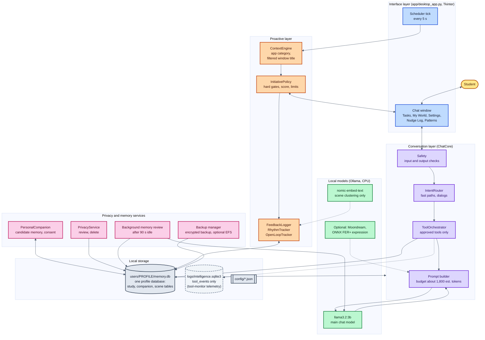
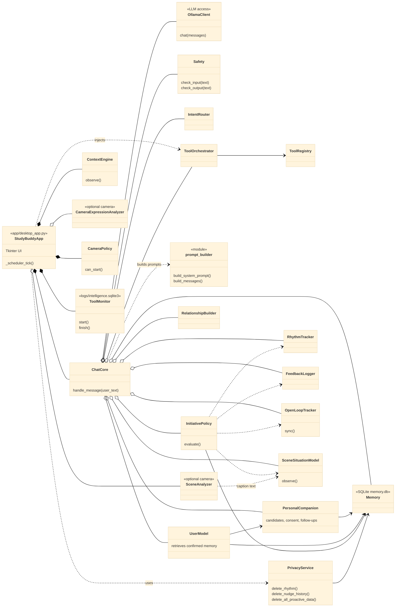
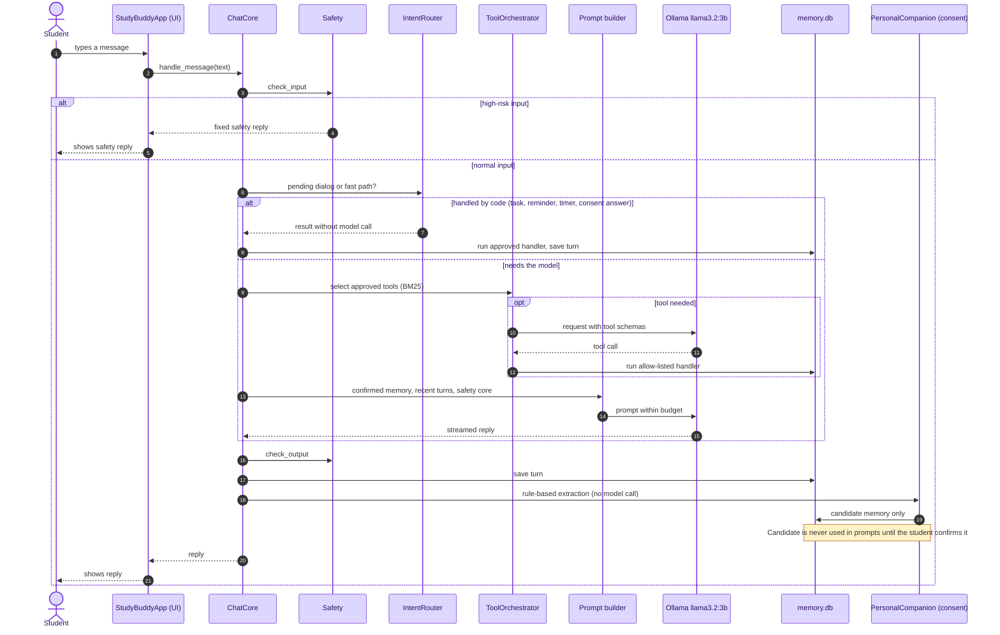
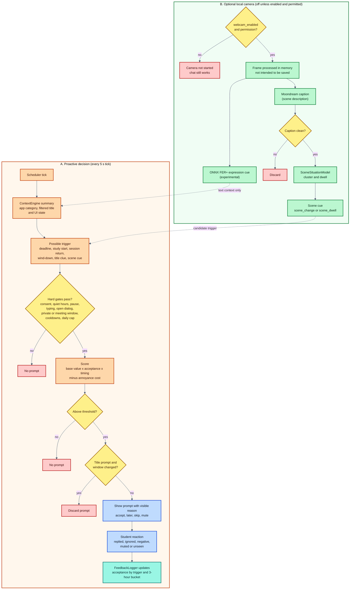
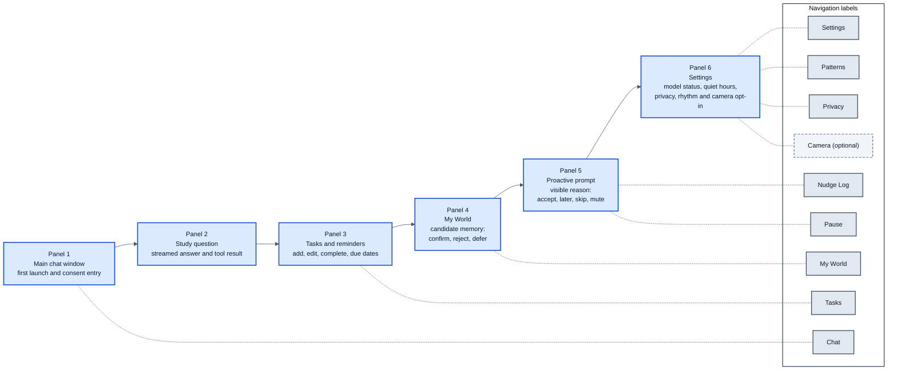

# Study Buddy v11 — Mermaid source for Figures 3.1 to 3.7

How to use: paste each block into https://mermaid.live, check it, then export as SVG or PNG (SVG is sharper for Word). Figure numbers and captions match the report. Names come from the real code (class names, table keys, foreign keys). Where the paper uses a short name, the code name is shown too.

Name mapping (paper to code):
- "DesktopApp" = class `StudyBuddyApp` in app/desktop_app.py
- "LLM" = class `OllamaClient` in app/llm.py
- "PromptBuilder" = module app/prompt_builder.py (functions `build_system_prompt`, `build_messages`), not a class
- "Safety" = class `Safety` in app/safety.py

---

## Figure 3.1. Study Buddy architecture with one profile database and separate tool telemetry

Note: the dashed telemetry database is separate and is not a second profile database.

---

## Figure 3.2. Use-case diagram for Study Buddy

Mermaid has no native use-case diagram, so this uses a flowchart with grouped subgraphs. Dashed use cases and the dashed optional-features group are off by default in code.

```mermaid
%%{init: {'theme':'base','flowchart':{'curve':'linear','nodeSpacing':20,'rankSpacing':40},'themeVariables':{'fontFamily':'Segoe UI, Arial','fontSize':'14px'}}}%%
flowchart TB
  S([Student]):::actor

  subgraph SYS["Study Buddy (Windows desktop)"]
    direction TB
    subgraph CORE_UC["Core features (always on)"]
      direction LR
      UC1(["Chat and ask study questions"]):::uc
      UC2(["Manage tasks"]):::uc
      UC3(["Set reminders and timers"]):::uc
    end
    subgraph MEM_UC["Memory and privacy controls"]
      direction LR
      UC4(["Review My World memory"]):::uc
      UC5(["Confirm, reject or defer memory candidates"]):::uc
      UC6(["Delete memory and activity data"]):::uc
    end
    subgraph PROMPT_UC["Proactive prompt controls"]
      direction LR
      UC7(["Pause, mute or stop prompts"]):::uc
      UC8(["View prompt reason and Nudge Log"]):::uc
      UC9(["Give prompt feedback"]):::uc
      UC10(["Set quiet hours and daily limit"]):::uc
    end
    subgraph SEC_UC["Security"]
      UC11(["Create or restore encrypted backup"]):::uc
    end
    subgraph OPT_UC["Optional features (off by default)"]
      direction LR
      UC12(["Enable rhythm tracking"]):::opt
      UC13(["Allow camera and scene cues"]):::opt
      UC14(["Use voice input and output"]):::opt
      UC15(["Encrypt profile folder with EFS"]):::opt
    end
  end

  O([Ollama / local model]):::ext
  Q([SQLite / local storage]):::ext

  S --> CORE_UC
  S --> MEM_UC
  S --> PROMPT_UC
  S --> SEC_UC
  S -.-> OPT_UC

  UC1 --- O
  UC1 --- Q
  UC2 --- Q
  UC3 --- Q
  UC13 -.- O

  classDef actor fill:#fde68a,stroke:#b45309,stroke-width:2px,color:#451a03
  classDef ext fill:#e2e8f0,stroke:#334155,stroke-width:2px,color:#0f172a
  classDef uc fill:#dbeafe,stroke:#1d4ed8,stroke-width:1.5px,color:#0f172a
  classDef opt fill:#f1f5f9,stroke:#64748b,stroke-width:1.5px,stroke-dasharray:5 3,color:#0f172a
  style SYS fill:#f8fafc,stroke:#334155,stroke-width:2px
  style CORE_UC fill:#eff6ff,stroke:#93c5fd,stroke-width:1px
  style MEM_UC fill:#fdf4ff,stroke:#d8b4fe,stroke-width:1px
  style PROMPT_UC fill:#fff7ed,stroke:#fdba74,stroke-width:1px
  style SEC_UC fill:#f0fdf4,stroke:#86efac,stroke-width:1px
  style OPT_UC fill:#f8fafc,stroke:#94a3b8,stroke-width:1px,stroke-dasharray:5 3
```

---

## Figure 3.3. Main class and service relationships

Real class names from the code. Only attributes and methods that exist in the source are listed.

---

## Figure 3.4. Sequence diagram for a normal chat turn

---

## Figure 3.5. Proactive initiative and optional camera processing flow

---

## Figure 3.6. Entity-relationship diagram for one profile database and separate tool-monitor telemetry

Solid lines are declared foreign keys (3 in the schema). Dotted lines are logical references with no FK constraint in the schema. `mood_daily` and `growth_log` are Phase 3 stubs, outside the evaluated scope. Composite keys are marked PK on each column of the key. If the diagram is too wide, split it into parts: (a) study tables, (b) companion tables, (c) scene tables.

```mermaid
erDiagram
  %% ===== users/PROFILE/memory.db : base study tables =====
  turns {
    int id PK
    real ts
    text role
    text text
  }
  facts {
    int id PK
    real ts
    text text "unique"
    text source
  }
  trusted_people {
    int id PK
    text name "unique"
  }
  profile {
    text key PK
    text value
  }
  notes {
    int id PK
    real ts
    text level
    text period
    text text
  }
  notes_fts {
    text text "FTS virtual index"
  }
  tasks {
    int id PK
    text title
    text details
    real due_ts
    text status
    real created_ts
    real completed_ts
  }
  reminders {
    int id PK
    text text
    real remind_ts
    int fired
    real created_ts
  }
  personality_versions {
    int id PK
    real created_ts
    text status
    text reason
    text character_json
    text evaluation_json
  }

  %% ===== companion tables =====
  personal_nodes {
    text id PK
    text label
    text kind
    text status
    int consented
    text evidence
    real importance
    text sensitivity
    text source
    real expires_ts
  }
  personal_edges {
    text id PK
    text source_id FK
    text target_id FK
    text relation
    text evidence
    real created_ts
  }
  candidate_queue {
    text node_id PK, FK
    real queued_ts
    int deferrals
    real last_prompted_ts
  }
  consent_ledger {
    int id PK
    real ts
    text scope
    int granted
    text note
  }
  companion_followups {
    text id PK
    real due_ts
    text kind
    text payload
    text status
  }
  companion_settings {
    text key PK
    text value
  }
  companion_events {
    int id PK
    real ts
    text kind
    text trigger
    text reason
    text meta
    text nudge_id
  }
  open_loops {
    text id PK
    text title
    text kind
    real due_ts
    text status
    int step
    text node_id "logical ref"
  }
  rhythm_buckets {
    int dow PK
    int hour PK
    text app_category PK
    real minutes
    int samples
    real updated_ts
  }
  rhythm_days {
    text day PK
    real updated_ts
  }
  trigger_stats {
    text trigger PK
    int hour_bucket PK
    real alpha
    real beta
    real updated_ts
  }
  mood_daily {
    text day PK
    real valence
    int n
  }
  growth_log {
    int id PK
    real ts
    text field
    text old
    text new
    text reason
    int reverted
  }

  %% ===== scene tables =====
  scene_obs {
    int id PK
    real ts
    text text
  }
  scene_clusters {
    int id PK
    text centroid
    int n
    real first_ts
    real last_ts
  }
  scene_visits {
    int id PK
    int cluster_id "logical ref"
    real start_ts
    real dwell_s
    int hour_bucket
    text day
  }
  scene_arms {
    int cluster_id PK "logical ref"
    int hour_bucket PK
    real alpha
    real beta
    real updated_ts
  }
  scene_arm_done {
    text nudge_id PK
  }
  scene_terms {
    int bucket PK
    int df
  }
  scene_meta {
    text key PK
    text value
  }

  %% ===== separate telemetry database: logs/intelligence.sqlite3 =====
  tool_events {
    int id PK
    text tool_id
    text tool_name
    text source
    text status
    real started_at
    real finished_at
    int duration_ms
    text summary
    text error
  }

  %% declared foreign keys (solid)
  personal_nodes ||--o{ personal_edges : "source_id"
  personal_nodes ||--o{ personal_edges : "target_id"
  personal_nodes ||--o| candidate_queue : "node_id"

  %% logical references, no FK constraint (dotted)
  personal_nodes ||..o{ open_loops : "node_id"
  scene_clusters ||..o{ scene_visits : "cluster_id"
  scene_clusters ||..o{ scene_arms : "cluster_id"
  notes ||..|| notes_fts : "text index"
```

Drawing note: put all tables above in one box labelled `users/<profile>/memory.db`. Draw `tool_events` in a separate small box labelled `logs/intelligence.sqlite3 (tool-monitor telemetry)` with no links to the profile box.

---

## Figure 3.7. User-interface storyboard and navigation flow

Use this as the navigation flow. Put your real screenshots into the six panels (Figure 3.7 in the report). Do not invent screens: take them from the working build.

